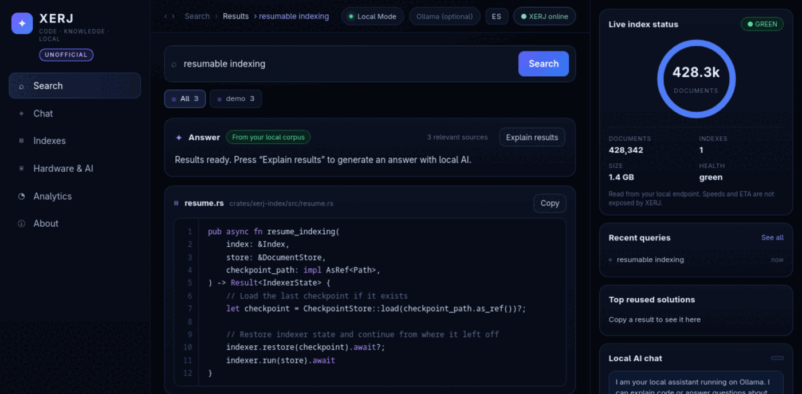
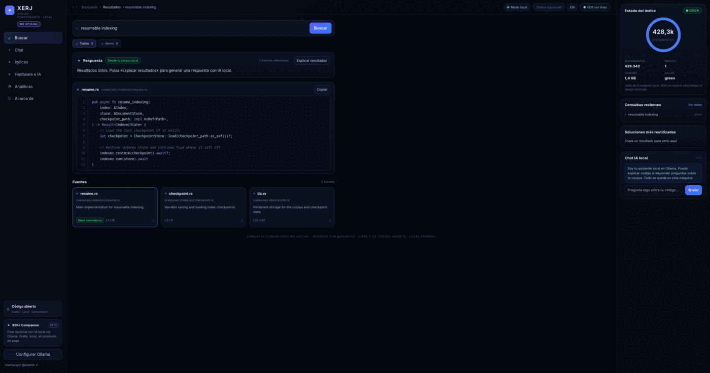
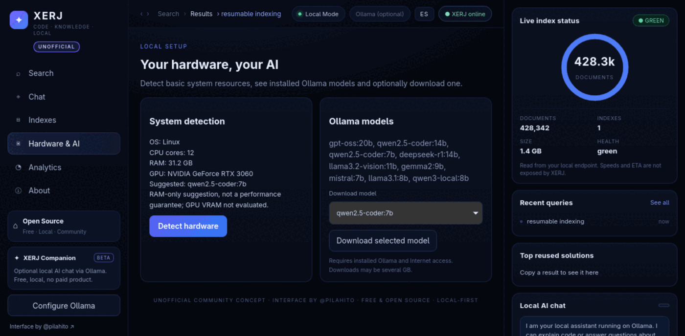

# XERJ Companion

[English](README.md) · **Español**

**Interfaz complementaria no oficial y local-first para [XERJ](https://github.com/xerj-org/xerj)**: busca en tu propio corpus, lee las fuentes resaltadas y pregúntale a un modelo local sobre ellas. Sin cuentas, sin telemetría y sin APIs de pago.

> **No oficial.** No está afiliada, revisada ni respaldada por el equipo de XERJ. Lo que se aporta es la interfaz: el motor y el código de XERJ no son míos y aquí no se modifican. Es una adaptación ofrecida a los creadores originales de XERJ, que pueden adoptarla, adaptarla o descartarla.



*Vista de búsqueda: pestañas por índice, respuesta basada en tus resultados, código resaltado con números de línea y una columna derecha con el estado real del índice, consultas recientes y chat con IA local.*

## Índice

- [Funciones](#funciones)
- [Ejecutarlo](#ejecutarlo) — navegador, escritorio, paquetes
- [Con qué habla](#con-qué-habla)
- [Estructura del proyecto](#estructura-del-proyecto)
- [Desarrollo](#desarrollo)
- [Problemas frecuentes](#problemas-frecuentes)
- [Límites y honestidad](#límites-y-honestidad)
- [Licencia](#licencia)

## Funciones

| | |
| --- | --- |
| **Búsqueda con fuentes** | Reenvía tu consulta al endpoint de búsqueda de XERJ y muestra los resultados con el código resaltado, números de línea, botón de copiar y pestañas por índice con contadores. |
| **Panel de respuesta** | «Explicar resultados» pide al modelo local que razone sobre los resultados recuperados, e indica cuántas fuentes usó y cuánto tardó. |
| **Panel del índice** | Documentos, número de índices, tamaño y salud leídos de `_cat/indices`, junto a tus consultas recientes y las fuentes que más copias. Se cuenta en `localStorage` y no se sube nada. |
| **Vista Índices** | La tabla real de índices y tamaño del corpus, tal cual la da tu endpoint. |
| **Vista Analíticas** | Tu historial de búsquedas y las fuentes que más reutilizas, guardados en esta máquina. |
| **Hardware e IA** | Núcleos de CPU, RAM, GPU NVIDIA si existe, modelos de Ollama instalados y descargas solo cuando las pides explícitamente. |
| **Bilingüe** | Interfaz completa en inglés y español; arranca en el idioma del sistema y recuerda el cambio. |



*Las tarjetas de fuentes conservan la ruta, la descripción y el rango de líneas; al elegir una, se carga en la tarjeta de código.*

## Ejecutarlo

Requiere **Python 3.9+**. La versión de navegador no necesita paquetes pip.

### Versión navegador

```bash
python3 server.py --port 8765
# abre http://127.0.0.1:8765
```

### Versión escritorio

```bash
python3 desktop.py
```

El mismo servidor, en una ventana nativa si tienes [pywebview](https://pywebview.flowrl.com/); si no, en una ventana de navegador en modo aplicación (Chrome, Chromium, Brave, Edge, Vivaldi, Opera) o tu navegador por defecto.

| Opción | Efecto |
| --- | --- |
| `--port 8765` | Puerto donde servir (por defecto `8765`). |
| `--browser` | Ignora pywebview y usa siempre una ventana de navegador. |
| `--no-open` | Solo servir, no abrir nada (útil en scripts y CI). |

### Paquetes

Los binarios están en [Releases](https://github.com/pilahito/XERJ-Companion/releases/latest):

| Plataforma | Fichero | Notas |
| --- | --- | --- |
| Windows | `XERJ-Companion.exe` | Un solo fichero. Sin firmar, SmartScreen puede avisar. |
| Linux (cualquiera) | `XERJ-Companion` | Binario único compilado en Ubuntu 24.04. La ventana nativa necesita `webkit2gtk`; si no, abre el navegador en modo aplicación. |
| Debian / Ubuntu | `xerj-companion_<version>_all.deb` | Añade una entrada al menú de aplicaciones. `sudo apt install ./xerj-companion_*_all.deb` |
| Arch | [packaging/PKGBUILD](packaging/PKGBUILD) | `makepkg -si` contra la etiqueta del release. |

Todo lo que hay en cada release lo construye [`.github/workflows/release.yml`](.github/workflows/release.yml) al empujar una etiqueta `v*`, así que los binarios corresponden al código de esa etiqueta. Ninguno está firmado todavía.

## Con qué habla

| Servicio | Por defecto | Necesario | Para qué |
| --- | --- | --- | --- |
| Endpoint de búsqueda de XERJ | `http://127.0.0.1:9200` | para buscar | Comprobar la versión en `/`, un `_search` compatible con Elasticsearch y `_cat/indices` para el panel. |
| [Ollama](https://ollama.com/download) | `http://127.0.0.1:11434` | solo para IA | `/api/tags` para los modelos instalados, `/api/generate` para las respuestas y `ollama pull` al pulsar descargar. |

El servidor solo escucha en `127.0.0.1`. El texto de tus consultas va a esos dos servicios locales y a ningún otro sitio; en el código no hay ningún endpoint de analíticas. Los campos de los resultados se leen por nombre (`path`/`file`, `text`/`content`, `lines`, `language`, `note`), así que si tu corpus usa otras claves, la tarjeta muestra el JSON completo del resultado.

## Estructura del proyecto

```
server.py              # servidor localhost: estáticos, /api/status, /api/search, /api/chat, /api/indices, /api/hardware, /api/models
desktop.py             # lanzador de escritorio (ventana pywebview o navegador en modo app)
index.html app.js      # la interfaz
style.css              # panel oscuro de tres columnas
i18n.json              # catálogos inglés/español con las mismas claves
test_server.py         # suite unittest (proxy, validación, cobertura de i18n)
packaging/             # spec de PyInstaller, empaquetador .deb, entrada .desktop, PKGBUILD, icono
.github/workflows/     # tests.yml (3.9 + 3.12) y release.yml (exe, binario, deb)
```

## Desarrollo

```bash
python3 -m unittest discover -v      # 7 pruebas: frontend, proxy, validación, i18n
python3 packaging/build_deb.py       # .deb usando solo la biblioteca estándar
pyinstaller packaging/xerj-companion.spec
```

## Problemas frecuentes

| Síntoma | Solución |
| --- | --- |
| La pastilla dice **XERJ sin conexión** | No hay nada escuchando en `:9200` o XERJ todavía no tiene índices. Arranca XERJ y recarga. |
| La búsqueda responde «Servicio local no disponible» | El endpoint devolvió un error: revisa los logs de XERJ y el nombre del índice. |
| **IA local no disponible** | Ollama no está corriendo o el modelo elegido no está instalado (`ollama list`). |
| El panel de hardware no detecta RAM/GPU | Solo se sondean Linux, macOS y Windows; la GPU necesita `nvidia-smi`. |
| La interfaz se ve vieja tras actualizar | Recarga forzada (`Ctrl+Shift+R`); el servidor solo manda `Cache-Control: no-store` para el JSON. |
| Windows avisa con el `.exe` | Es normal: el binario no está firmado. Puedes compilarlo tú desde la etiqueta. |

## Límites y honestidad

- Es un **prototipo**, no una integración de producción validada. El equipo de XERJ puede adoptarlo, adaptarlo o descartarlo.
- La maqueta de la propuesta mostraba `68 %`, `docs/segundo` y un tiempo estimado. XERJ no expone la velocidad ni el progreso de indexado, así que esta app muestra recuentos y salud reales en lugar de inventar cifras.
- Solo escucha en localhost; no está pensada para despliegue público.
- Copyright 2026 pilahito. Código ofrecido bajo [Apache License 2.0](LICENSE). Ivan y los mantenedores de XERJ pueden evaluarlo, adaptarlo o distribuirlo con la atribución aplicable.


